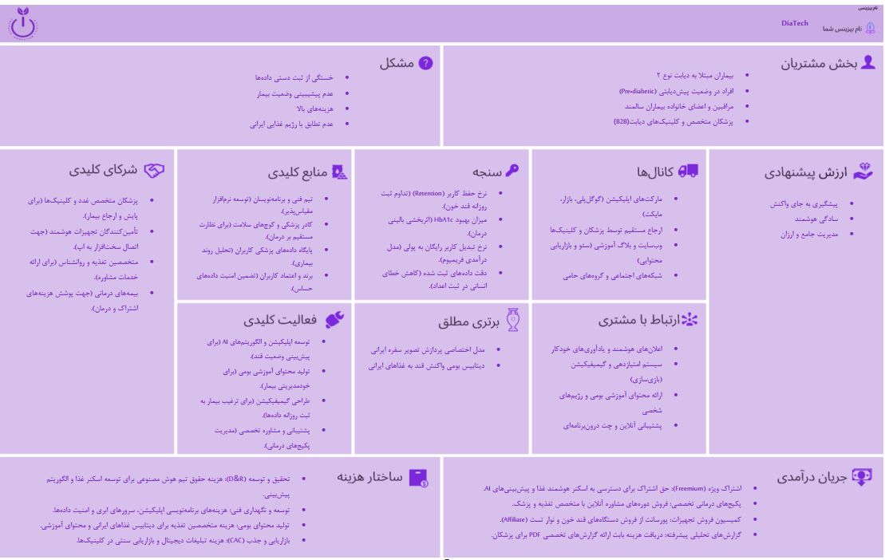

# DiaTech: a diabetes self-care concept

**Would people with type-2 diabetes keep using a self-care app?** That turned out to be the real question. Ten interviews moved our concept from logging everything to logging a little every day, built around Iranian food and the family member who worries.

*Product discovery · interviews · competitor analysis · MVP feedback* · Reports in Persian: [Discovery and validation](docs/discovery-and-validation-fa.pdf) · [Presentation](docs/presentation-fa.pdf)

## What we did

- Interviewed 10 people in three groups: patients with type-2 diabetes or prediabetes, family caregivers, and doctors and nutritionists.
- Compared existing apps, including mySugr, Glucose Buddy and One Drop.
- Tested an MVP with classmates and revised the business model from their feedback.
- **My part:** the deeper competitor analysis, interviews, and the presentation slides and video.

## What we found

- **The risk isn't the problem, it's sticking with the solution.** Everyone agreed diabetes needs daily care; the open question is whether people keep using an app.
- **Iranian food is the gap.** How much oil is in ghormeh sabzi? What does tahdig do to blood sugar? Foreign calorie counters can't say, and it was the point raised most often.
- **The payer is often the worried family member,** not the patient who has gotten used to the condition. "He has no patience for apps. I install them for him."
- **Retention over features.** We cut low-use features and aimed for a little logging every day, measured by daily against monthly active users rather than installs.

## Files

| Path | What's there |
| --- | --- |
| [`docs/discovery-and-validation-fa.pdf`](docs/discovery-and-validation-fa.pdf) | Interview questions and answers, insight tables and pivot decisions (37 pages) |
| [`docs/presentation-fa.pdf`](docs/presentation-fa.pdf) | The project presentation |
| [`assets/business-model-canvas.png`](assets/business-model-canvas.png) | The business model canvas |

**NGC Group (Next Generation Coders):** Moeinreza Bagheri, Amirhossein Moallemi, Nazanin Salehi and Mohsen Moshrefi. Startup Development course, University of Isfahan, 2025. A course concept, not a launched product.
